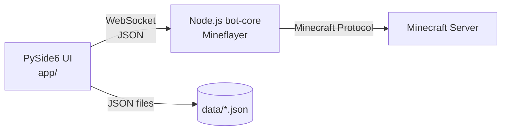

# Архитектура MC Bot Suite

## Общая схема



## Процессы

Проект использует **двухпроцессную клиент-серверную архитектуру**:

- **`app/`** — Python UI (клиент). Управляет настройками, отображает состояние, шлёт команды.
- **`bot-core/`** — Node.js бот (сервер). Держит соединение с Minecraft, выполняет навигацию, чат, статистику.

Связь — через **WebSocket** на `ws://127.0.0.1:34567`. Формат сообщений — JSON. См. `docs/PROTOCOL.md`.

## Модули Python (`app/`)

```
app/
├── main.py                 # точка входа, применение темы и языка
├── i18n.py                 # словарь RU/EN + функции tr(), set_language()
├── core/
│   ├── bot_client.py       # WS-клиент (в отдельном потоке)
│   ├── events.py           # шина событий (Qt signals)
│   └── state.py            # модель состояния бота
├── modules/
│   ├── storage.py          # атомарное JSON-хранилище
│   └── theme.py            # генератор QSS-тем (6 пресетов + custom)
└── ui/
    ├── main_window.py      # главное окно
    ├── tabs/
    │   ├── routes_tab.py
    │   ├── messages_tab.py
    │   ├── inventory_tab.py
    │   └── control_tab.py
    ├── widgets/
    │   ├── toast.py        # всплывающие уведомления
    │   ├── minimap.py      # 2D-карта с треком
    │   └── color_picker.py # свой color picker
    └── theme/
        └── icon.png
```

## Модули Node.js (`bot-core/`)

```
bot-core/
├── src/
│   ├── index.js            # WS-сервер, маршрутизация команд
│   ├── BotController.js    # обёртка над Mineflayer
│   ├── RouteRunner.js      # выполнение маршрутов
│   ├── ChatScheduler.js    # планировщик автосообщений
│   ├── StatsTracker.js     # сбор статистики
│   ├── SafetyMonitor.js    # реакция на низкое HP/голод
│   ├── InventoryManager.js # инвентарь + eat/drop
│   ├── AutoEater.js        # автопитание
│   ├── CombatController.js # авто-удар (1.20.4-)
│   ├── i18n.js             # словарь RU/EN + t()
│   └── protocol.js         # константы CMD/EVT
└── package.json
```

## Поток данных

1. **Пользователь → UI**: клик по кнопке.
2. **UI → bot-core**: `BotClient.send_command("connect", {...})`.
3. **bot-core → Minecraft**: `mineflayer.createBot(...)`.
4. **Minecraft → bot-core**: события (`spawn`, `health`, `move`, `chat`, ...).
5. **bot-core → UI**: `broadcast("state", {...})`.
6. **UI → пользователю**: обновление виджетов через `bus.state_updated`.

## Локализация

**Два словаря** — RU и EN:
- `app/i18n.py` — все UI-строки.
- `bot-core/src/i18n.js` — все логи от Node.

**Синхронизация языка**: при смене языка UI отправляет команду `set_language` в bot-core. Язык хранится в `settings.json.ui.language`.

## Темы и цвета

Генератор `app/modules/theme.py` строит QSS **на лету** из базовой палитры:

- 6 предустановленных тем (`dark_blue`, `dark_gray`, `dark_green`, `dark_purple`, `light`, `minecraft`).
- Custom: пользователь выбирает цвет фона через свой color picker; программа вычисляет производные (panel, border, accent, text) и **автоматически подбирает контрастный текст**.

Текущая тема: `settings.json.ui.theme` и `ui.custom_bg`.

## Расширение

Архитектура готова к:

- **Мультибот**: вместо одного `BotController` — словарь по ID. UI подписывается на `bot:ID:state`.
- **Удалённое управление**: заменить `ws://127.0.0.1` на IP сервера, добавить TLS и токен-авторизацию.
- **Плагины**: модули `bot-core/src/plugins/*.js` регистрируются в `BotController`, UI подгружает вкладки динамически.
- **Продвинутая навигация**: заменить `pathfinder` на собственный A* по чанкам.
- **3D-вид**: подключить `prismarine-viewer` и встроить в `QWebEngineView`.